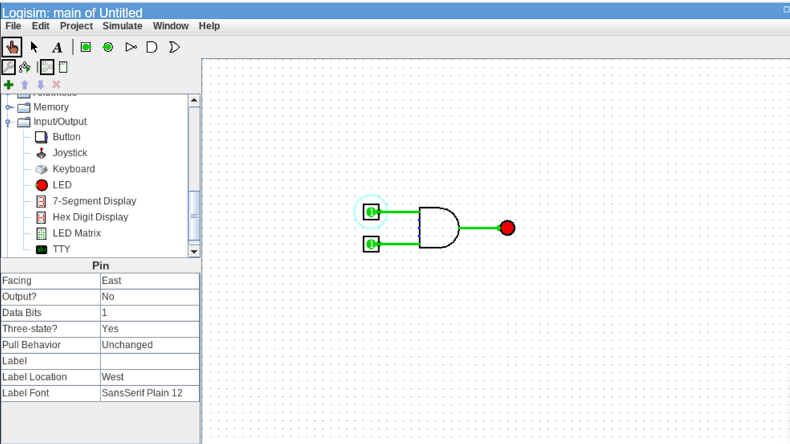
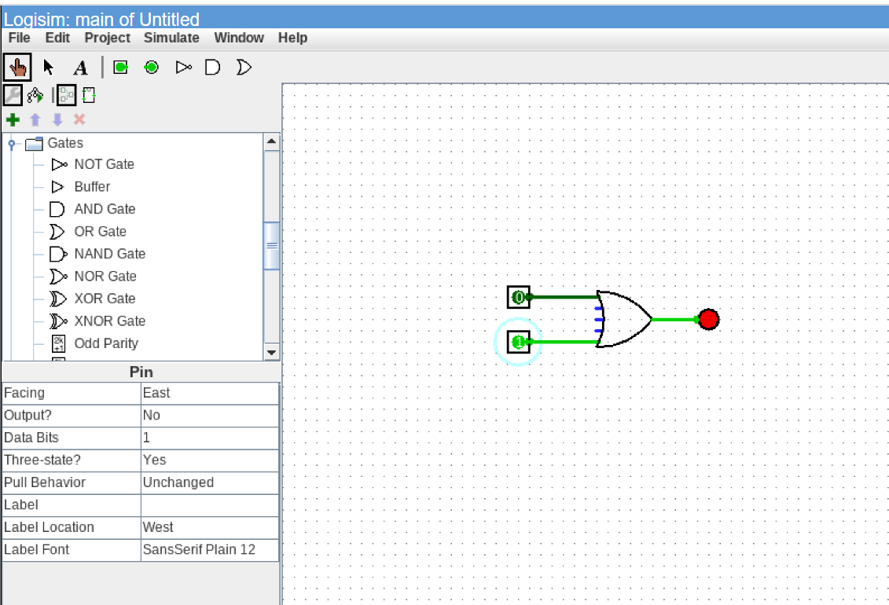
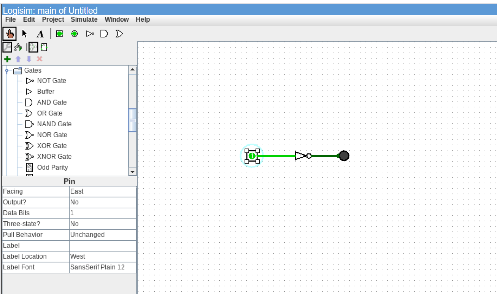
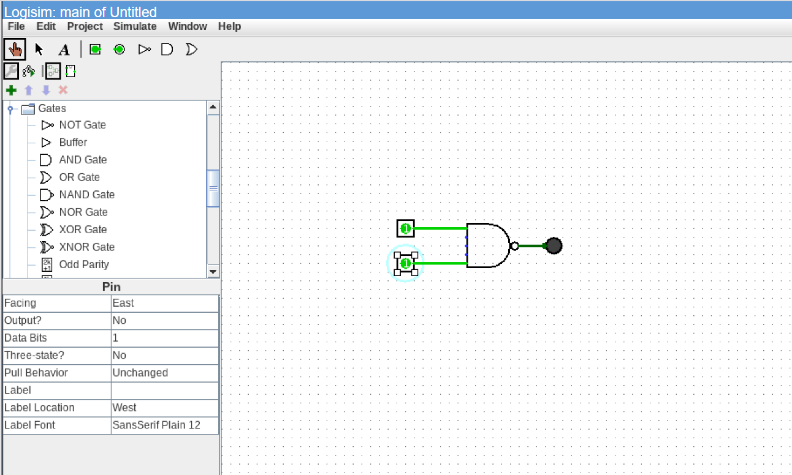
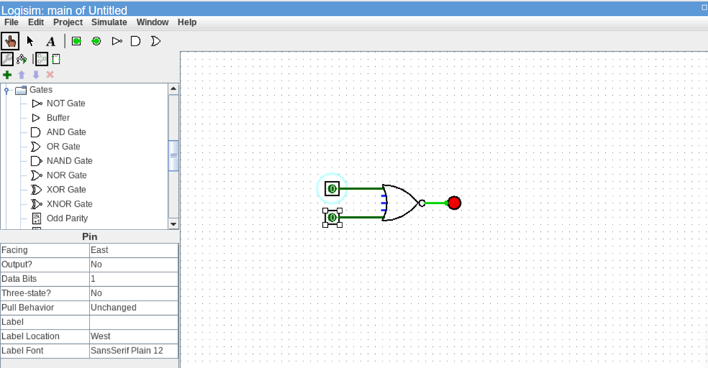
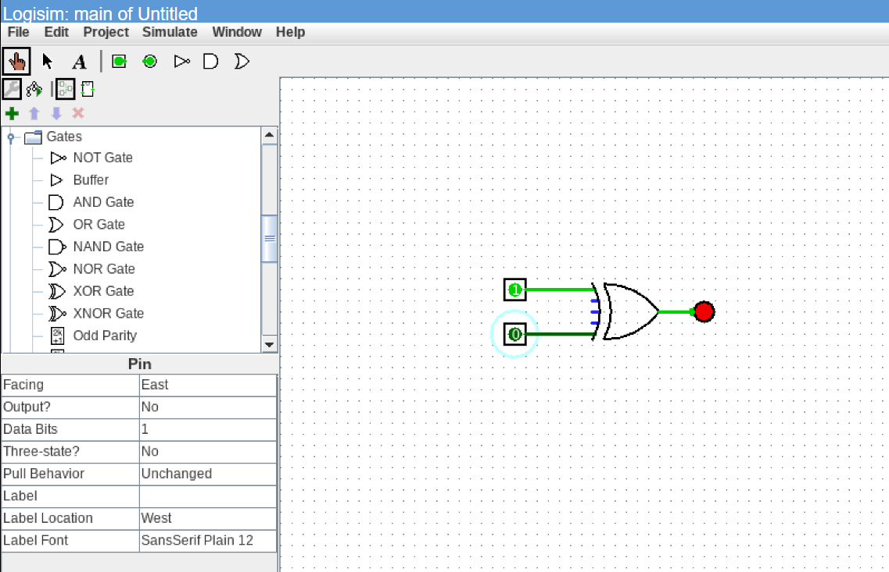
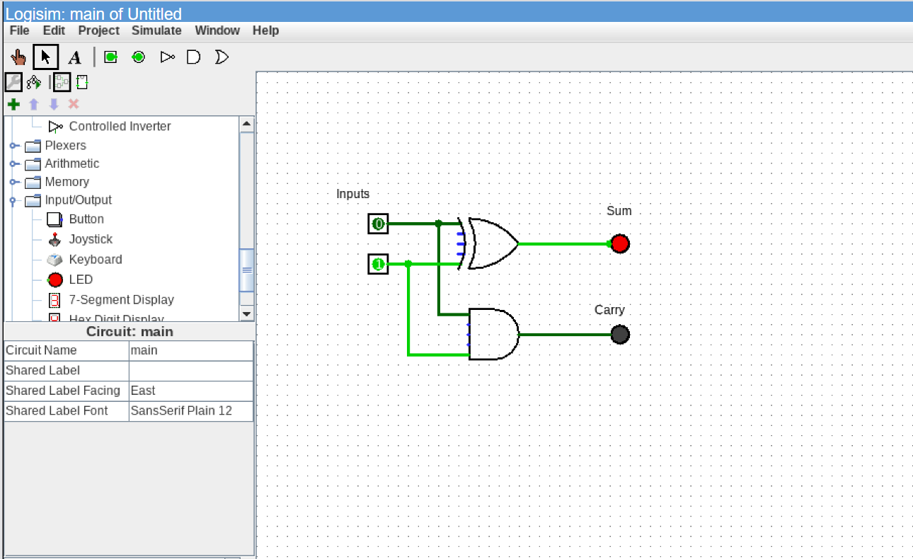

# Task 1 – Introduction to VLSI Design Flow & Digital Logic Simulation

## 📌 Overview

This task introduces the fundamental principles of **Very Large Scale Integration (VLSI)**, covers the industry-standard **VLSI Design Flow**, and demonstrates the implementation and verification of basic logic gates and combinational circuits using a digital logic simulator (**Logisim**).

---

## 🎯 Objectives

- Understand the fundamentals and applications of VLSI technology.
- Study the complete 9-step VLSI Design Flow from specification to silicon validation.
- Implement and simulate basic digital logic gates (AND, OR, NOT, NAND, NOR, XOR).
- Design and simulate a Half Adder circuit using logic gates.
- Verify theoretical truth tables against simulated output waveforms and states.

---

## 🏗️ The VLSI Design Flow

The design of modern integrated circuits follows a structured multi-stage flow:

```
[1. System Specification]
          ↓
[2. Architecture Design]
          ↓
[3. RTL Design (Verilog/VHDL)]
          ↓
[4. Functional Verification]
          ↓
[5. Logic Synthesis (Gate Netlist)]
          ↓
[6. Physical Design (Floorplanning, P&R, CTS)]
          ↓
[7. Timing & Power Analysis (STA)]
          ↓
[8. Fabrication (Foundry Manufacturing)]
          ↓
[9. Testing & Packaging]
```

1. **System Specification:** Defining functional requirements, performance targets, power envelope, and silicon area constraints.
2. **Architecture Design:** Partitioning the system into micro-architectural building blocks (datapath, control, memory interfaces).
3. **RTL Design:** Writing synthesizable code using Hardware Description Languages (HDLs) such as Verilog, SystemVerilog, or VHDL.
4. **Functional Verification:** Simulating RTL modules using testbenches to ensure functional correctness prior to implementation.
5. **Logic Synthesis:** Translating RTL code into an optimized gate-level netlist mapped to a target foundry standard-cell library.
6. **Physical Design:** Translating the netlist to geometric layout (floorplanning, power planning, placement, Clock Tree Synthesis [CTS], and routing).
7. **Timing and Power Analysis:** Performing Static Timing Analysis (STA), design rule checks (DRC), layout vs. schematic (LVS), and power integrity verification.
8. **Fabrication:** Transferring layout masks onto silicon wafers through photolithography in a semiconductor fab.
9. **Testing and Validation:** Post-silicon functional, electrical, and stress testing of packaged chips.

---

## 🔬 Digital Logic Simulation (Logisim)

All basic digital logic gates and the Half Adder combinational circuit were implemented and verified in **Logisim**.

### 1. AND Gate
- **Boolean Expression:** `Y = A · B`
- **Truth Table:**

| A | B | Y |
|:---:|:---:|:---:|
| 0 | 0 | 0 |
| 0 | 1 | 0 |
| 1 | 0 | 0 |
| 1 | 1 | 1 |



---

### 2. OR Gate
- **Boolean Expression:** `Y = A + B`
- **Truth Table:**

| A | B | Y |
|:---:|:---:|:---:|
| 0 | 0 | 0 |
| 0 | 1 | 1 |
| 1 | 0 | 1 |
| 1 | 1 | 1 |



---

### 3. NOT Gate (Inverter)
- **Boolean Expression:** `Y = A'`
- **Truth Table:**

| A | Y |
|:---:|:---:|
| 0 | 1 |
| 1 | 0 |



---

### 4. NAND Gate (Universal Gate)
- **Boolean Expression:** `Y = (A · B)'`
- **Truth Table:**

| A | B | Y |
|:---:|:---:|:---:|
| 0 | 0 | 1 |
| 0 | 1 | 1 |
| 1 | 0 | 1 |
| 1 | 1 | 0 |



---

### 5. NOR Gate (Universal Gate)
- **Boolean Expression:** `Y = (A + B)'`
- **Truth Table:**

| A | B | Y |
|:---:|:---:|:---:|
| 0 | 0 | 1 |
| 0 | 1 | 0 |
| 1 | 0 | 0 |
| 1 | 1 | 0 |



---

### 6. XOR Gate
- **Boolean Expression:** `Y = A ⊕ B = A'B + AB'`
- **Truth Table:**

| A | B | Y |
|:---:|:---:|:---:|
| 0 | 0 | 0 |
| 0 | 1 | 1 |
| 1 | 0 | 1 |
| 1 | 1 | 0 |



---

### 7. Half Adder
A Half Adder computes the arithmetic sum of two 1-bit binary inputs, producing a `Sum` and a `Carry`.
- **Boolean Expressions:**
  - `Sum = A ⊕ B`
  - `Carry = A · B`
- **Truth Table:**

| A | B | Sum | Carry |
|:---:|:---:|:---:|:---:|
| 0 | 0 | 0 | 0 |
| 0 | 1 | 1 | 0 |
| 1 | 0 | 1 | 0 |
| 1 | 1 | 0 | 1 |



---

## 📁 Folder Structure

```
Task-1/
├── Report/
│   └── VLSI_Task_1_Report.docx
├── Screenshots/
│   ├── and_gate.png
│   ├── half_adder.png
│   ├── nand_gate.png
│   ├── nor_gate.png
│   ├── not_gate.png
│   ├── or_gate.png
│   └── xor_gate.png
└── README.md
```

---

## 📝 Key Observations & Conclusion

1. Successfully modeled and verified all six basic logic gates and the Half Adder combinational circuit.
2. Verified all truth table input-output states against active simulation probe values.
3. Established foundational understanding of gate-level design and the VLSI engineering pipeline required for RTL modeling in Verilog HDL.
