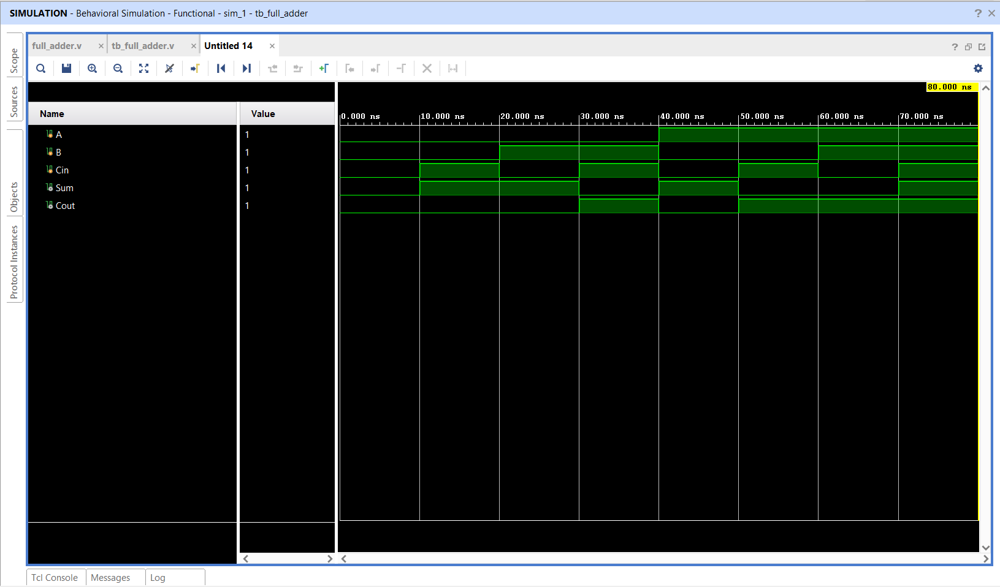

# Full Adder using Verilog HDL

## 📌 Objective

Design and simulate a 1-bit Full Adder combinational circuit supporting carry-in (`cin`) using Verilog HDL.

---

## 🔬 Boolean Equations

- **Sum:** `sum = a ^ b ^ cin`
- **Cout:** `cout = (a & b) | (b & cin) | (a & cin)`

---

## 📁 Source Files

| File | Description |
|------|-------------|
| [`full_adder.v`](full_adder.v) | RTL implementation of 1-bit Full Adder |
| [`tb_full_adder.v`](tb_full_adder.v) | Testbench applying all 8 combinations of `(a, b, cin)` |
| [`full_adder_waveform.png`](full_adder_waveform.png) | Simulation waveform captured from Vivado |

---

## 📊 Truth Table

| `a` | `b` | `cin` | Sum (`sum`) | Carry Out (`cout`) |
|:---:|:---:|:---:|:---:|:---:|
| 0 | 0 | 0 | 0 | 0 |
| 0 | 0 | 1 | 1 | 0 |
| 0 | 1 | 0 | 1 | 0 |
| 0 | 1 | 1 | 0 | 1 |
| 1 | 0 | 0 | 1 | 0 |
| 1 | 0 | 1 | 0 | 1 |
| 1 | 1 | 0 | 0 | 1 |
| 1 | 1 | 1 | 1 | 1 |

---

## 📈 Simulation Waveform

Behavioral simulation was performed in **Xilinx Vivado 2025.2**.

---

## ✅ Result

The Full Adder was successfully designed, simulated, and verified across all 8 input combinations.
