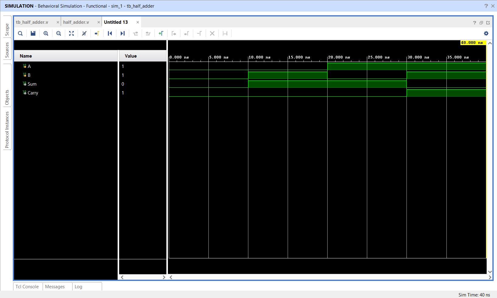

# Half Adder using Verilog HDL

## 📌 Objective

Design and simulate a 1-bit Half Adder circuit using Verilog HDL RTL modeling.

---

## 🔬 Boolean Equations

- **Sum:** `sum = a ^ b`
- **Carry:** `carry = a & b`

---

## 📁 Source Files

| File | Description |
|------|-------------|
| [`halfadder.v`](halfadder.v) | Verilog RTL module for Half Adder |
| [`tb_halfadder.v`](tb_halfadder.v) | Testbench exercising all combinations of `(a, b)` |
| [`half_adder_waveform.png`](half_adder_waveform.png) | Simulation waveform captured from Vivado |

---

## 📊 Truth Table

| `a` | `b` | Sum (`sum`) | Carry (`carry`) |
|:---:|:---:|:---:|:---:|
| 0 | 0 | 0 | 0 |
| 0 | 1 | 1 | 0 |
| 1 | 0 | 1 | 0 |
| 1 | 1 | 0 | 1 |

---

## 📈 Simulation Waveform

Behavioral simulation was conducted in **Xilinx Vivado 2025.2**.

---

## ✅ Result

The Half Adder RTL design accurately computes sum and carry bits matching expected boolean operations across all input conditions.
