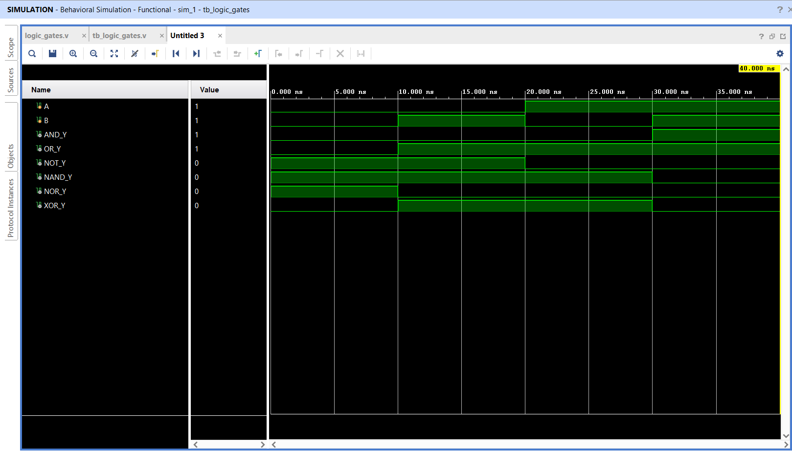

# Logic Gates using Verilog HDL

## 📌 Objective

Design, model, and simulate all basic combinational logic gates using Verilog HDL RTL continuous assignment.

---

## 🔬 Implemented Gates & Logic Expressions

- **AND:** `y_and = a & b`
- **OR:** `y_or = a | b`
- **NOT:** `y_not = ~a`
- **NAND:** `y_nand = ~(a & b)`
- **NOR:** `y_nor = ~(a | b)`
- **XOR:** `y_xor = a ^ b`

---

## 📁 Source Files

| File | Description |
|------|-------------|
| [`logicgates.v`](logicgates.v) | Verilog RTL module modeling all 6 gates |
| [`tb_logicgates.v`](tb_logicgates.v) | Testbench applying all combinations of `(a, b)` |
| [`logic_gates_waveform.png`](logic_gates_waveform.png) | Simulation waveform captured from Vivado |

---

## 📊 Truth Table

| `a` | `b` | AND (`y_and`) | OR (`y_or`) | NOT (`y_not`) | NAND (`y_nand`) | NOR (`y_nor`) | XOR (`y_xor`) |
|:---:|:---:|:---:|:---:|:---:|:---:|:---:|:---:|
| 0 | 0 | 0 | 0 | 1 | 1 | 1 | 0 |
| 0 | 1 | 0 | 1 | 1 | 1 | 0 | 1 |
| 1 | 0 | 0 | 1 | 0 | 1 | 0 | 1 |
| 1 | 1 | 1 | 1 | 0 | 0 | 0 | 0 |

---

## 📈 Simulation Waveform

Behavioral simulation was performed using **Xilinx Vivado 2025.2 Simulator (xsim)**.

---

## ✅ Result

All six logic gates operated according to digital logic specifications and were verified under all input stimulus conditions.
