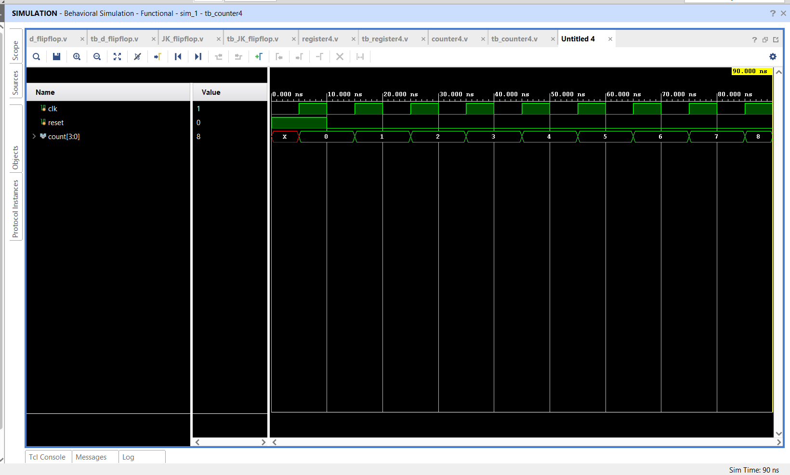

# 4-Bit Binary Counter using Verilog HDL

## 📌 Objective

Design and simulate a synchronous **4-bit Binary Up-Counter** with active-high synchronous reset using Verilog HDL.

---

## 🔬 Theory & Operation

A 4-bit binary counter cycles through binary values from `0000` (0) to `1111` (15) on consecutive active clock edges.
- When `reset = 1`, output `count` resets synchronously to `4'b0000`.
- When `reset = 0`, output increments: `count <= count + 1'b1`.
- Upon reaching `4'b1111`, the counter rolls over naturally to `4'b0000`.

---

## 📁 Source Files

| File | Description |
|------|-------------|
| [`counter4.v`](counter4.v) | Verilog RTL module for synchronous 4-bit counter |
| [`tb_counter4.v`](tb_counter4.v) | Testbench initializing reset and advancing count cycles |
| [`counter4_waveform.png`](counter4_waveform.png) | Simulation waveform captured from Vivado |

---

## 📊 State Progression

```
0000 (0) → 0001 (1) → 0010 (2) → 0011 (3) → 0100 (4) → ... → 1111 (15) → 0000 (0)
```

---

## 📈 Simulation Waveform

Behavioral simulation in **Xilinx Vivado**:



---

## ✅ Result

The 4-bit counter accurately held at `0000` during reset assertion and correctly sequenced through up-counting cycles synchronously on positive clock edges.
