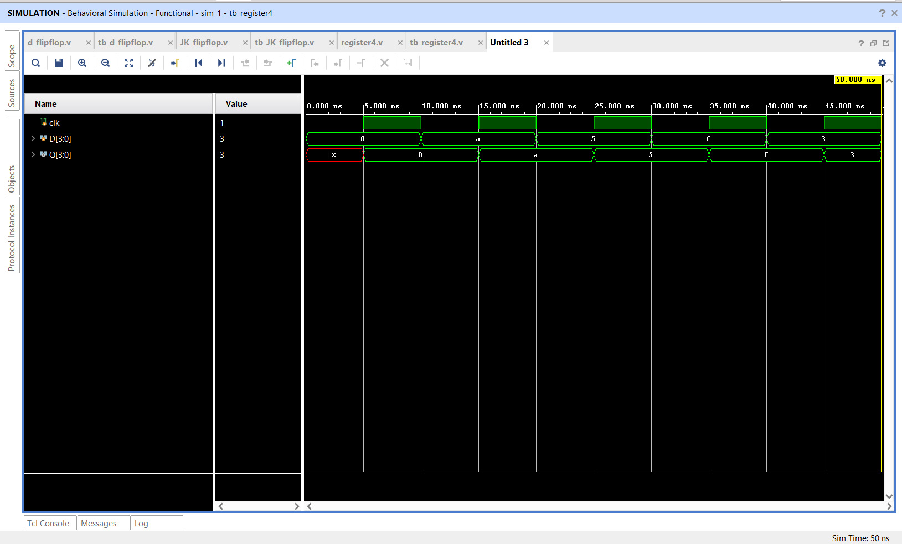

# 4-Bit Register using Verilog HDL

## 📌 Objective

Design and simulate a **4-bit parallel register** for synchronous multi-bit data storage using Verilog HDL.

---

## 🔬 Theory & Operation

A 4-bit register comprises four D-type storage elements connected to a common clock line. On every rising edge of the clock signal, the 4-bit input vector `D[3:0]` is latched and appears at the 4-bit output vector `Q[3:0]`.

---

## 📁 Source Files

| File | Description |
|------|-------------|
| [`register4.v`](register4.v) | Verilog RTL module for 4-bit synchronous register |
| [`tb_register4.v`](tb_register4.v) | Testbench applying various 4-bit test patterns (`1010`, `0101`, `1111`, `0011`) |
| [`register4_waveform.png`](register4_waveform.png) | Simulation waveform captured from Vivado |

---

## 📊 Stimulus & Operation Table

| Time (ns) | Clock Edge | Data Input `D[3:0]` | Register Output `Q[3:0]` |
|:---:|:---:|:---:|:---:|
| 0 | Initial | `4'b0000` | `4'b0000` |
| 10 | `↑` | `4'b1010` (10) | `4'b1010` (10) |
| 20 | `↑` | `4'b0101` (5) | `4'b0101` (5) |
| 30 | `↑` | `4'b1111` (15) | `4'b1111` (15) |
| 40 | `↑` | `4'b0011` (3) | `4'b0011` (3) |

---

## 📈 Simulation Waveform

Behavioral simulation in **Xilinx Vivado**:

---

## ✅ Result

The 4-bit register successfully latched and held various 4-bit parallel binary patterns synchronous with the rising clock edge.
