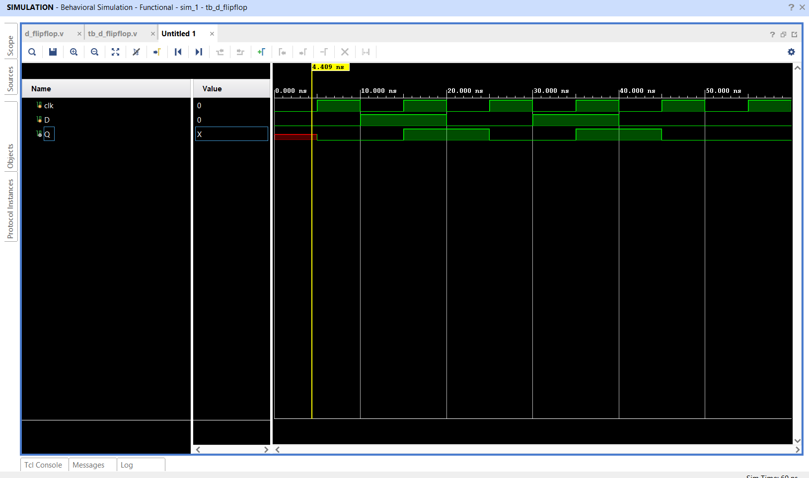

# D Flip-Flop using Verilog HDL

## 📌 Objective

Design and simulate a positive-edge-triggered **D (Data) Flip-Flop** using Verilog HDL.

---

## 🔬 Theory & Operation

A D Flip-Flop captures the state of the data input (`D`) precisely at the rising edge (`posedge`) of the clock signal (`clk`) and holds this value on the output (`Q`) until the subsequent rising edge.

- **Characteristic Equation:** `Q_next = D`

---

## 📁 Source Files

| File | Description |
|------|-------------|
| [`d_flipflop.v`](d_flipflop.v) | Verilog RTL behavioral implementation |
| [`tb_d_flipflop.v`](tb_d_flipflop.v) | Testbench applying alternating `D` inputs across clock pulses |
| [`d_flipflop_waveform.png`](d_flipflop_waveform.png) | Simulation waveform captured from Vivado |

---

## 📊 Truth Table

| Clock (`clk`) | Input (`D`) | Output (`Q_next`) |
|:---:|:---:|:---:|
| 0 | X | Q (No change) |
| 1 | X | Q (No change) |
| `↑` (Rising Edge) | 0 | 0 |
| `↑` (Rising Edge) | 1 | 1 |

---

## 📈 Simulation Waveform

Behavioral simulation in **Xilinx Vivado**:

---

## ✅ Result

Waveform verification confirms that the output `Q` transitions to input `D` exclusively on the rising edge of `clk`, ignoring intermediate transitions during the clock low/high phases.
