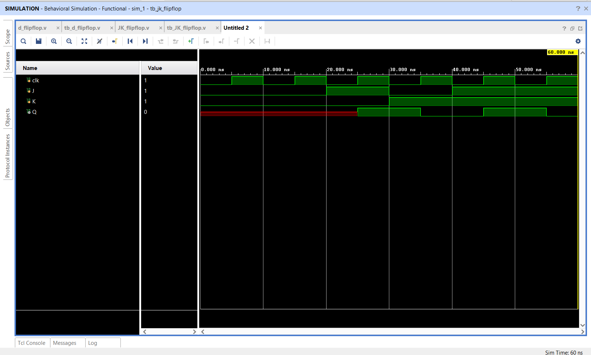

# JK Flip-Flop using Verilog HDL

## 📌 Objective

Design and simulate a positive-edge-triggered **JK Flip-Flop** supporting Hold, Reset, Set, and Toggle operating modes using Verilog HDL.

---

## 🔬 Theory & Operation

The JK flip-flop eliminates the undefined/invalid state condition of an SR flip-flop when both inputs are HIGH (`J = 1, K = 1`), instead causing the output state to invert (**Toggle**).

- **Characteristic Equation:** `Q_next = J·Q' + K'·Q`

---

## 📁 Source Files

| File | Description |
|------|-------------|
| [`jk_flipflop.v`](jk_flipflop.v) | Verilog RTL behavioral implementation using `case ({J, K})` |
| [`tb_jk_flipflop.v`](tb_jk_flipflop.v) | Testbench exercising Hold, Set, Reset, and Toggle states |
| [`jk_flipflop_waveform.png`](jk_flipflop_waveform.png) | Simulation waveform captured from Vivado |

---

## 📊 Truth Table

| Clock (`clk`) | `J` | `K` | Output (`Q_next`) | Function / Mode |
|:---:|:---:|:---:|:---:|:---|
| `↑` | 0 | 0 | `Q` | Hold (No Change) |
| `↑` | 0 | 1 | 0 | Reset |
| `↑` | 1 | 0 | 1 | Set |
| `↑` | 1 | 1 | `~Q` | Toggle |

---

## 📈 Simulation Waveform

Behavioral simulation in **Xilinx Vivado**:

---

## ✅ Result

All four operating states (Hold, Set, Reset, Toggle) were demonstrated and verified against the excitation table.
