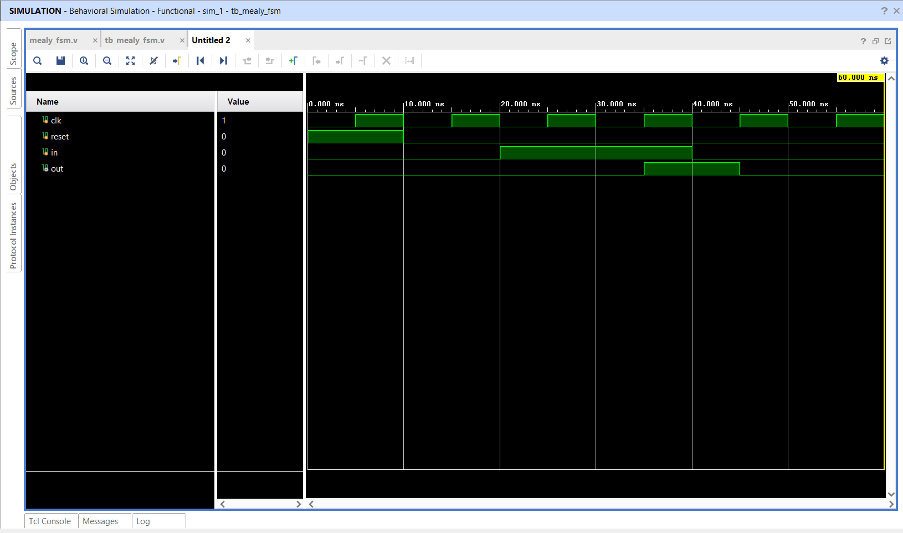

# Mealy Finite State Machine (FSM)

## 📌 Objective

Design and simulate a 2-state Mealy FSM where the primary output `out` is a function of both the current state and the current input signal.

---

## 🔬 State Transitions & Condition

The FSM generates an active-high pulse `out = 1` when the machine is in state **S1** and receives an input `in = 1`.

---

## 📁 Source Files

| File | Description |
|------|-------------|
| [`mealy_fsm.v`](mealy_fsm.v) | Verilog RTL module modeling the Mealy FSM |
| [`tb_mealy_fsm.v`](tb_mealy_fsm.v) | Testbench applying directed input stimuli |
| [`mealy_fsm_waveform.png`](mealy_fsm_waveform.png) | Simulation waveform captured from Vivado |

---

## 📊 State & Output Transition Table

| Current State | State Code | Input `in` | Next State | Next State Code | Output `out` |
|:---:|:---:|:---:|:---:|:---:|:---:|
| S0 | `1'b0` | 0 | S0 | `1'b0` | 0 |
| S0 | `1'b0` | 1 | S1 | `1'b1` | 0 |
| S1 | `1'b1` | 0 | S0 | `1'b0` | 0 |
| S1 | `1'b1` | 1 | S0 | `1'b0` | **1** |

---

## 📈 Simulation Waveform

Behavioral simulation in **Xilinx Vivado**:

---

## ✅ Result

Vivado behavioral simulation confirmed that `out` goes HIGH (`1`) exclusively when `state == S1` and `in == 1`, returning to `0` and state `S0` on the subsequent cycle.
