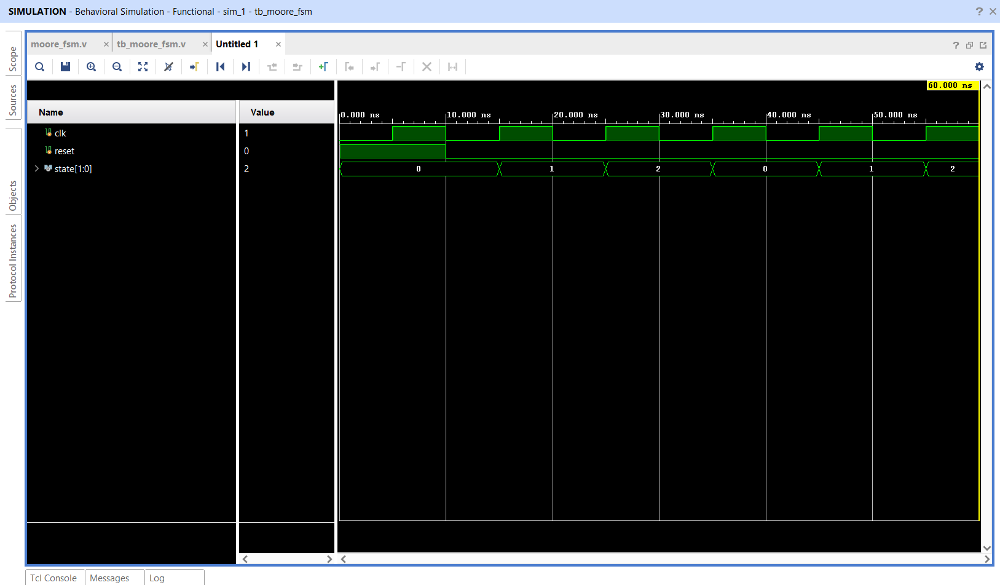

# Moore Finite State Machine (FSM)

## 📌 Objective

Design and simulate a 3-state Moore FSM where output values are strictly determined by the current state.

---

## 🔬 State Sequence & Encoding

- **States:** `S0 (2'b00) → S1 (2'b01) → S2 (2'b10) → S0`
- **Output:** The 2-bit state register `state[1:0]` is exposed directly as the output.
- **Clocking:** Positive-edge triggered with asynchronous active-high reset.

---

## 📁 Source Files

| File | Description |
|------|-------------|
| [`moore_fsm.v`](moore_fsm.v) | Verilog RTL module modeling the Moore FSM |
| [`tb_moore_fsm.v`](tb_moore_fsm.v) | Testbench initializing reset and observing state progression |
| [`moore_fsm_waveform.png`](moore_fsm_waveform.png) | Simulation waveform captured from Vivado |

---

## 📊 State Transition Table

| Current State | Encoding | Next State | Encoding |
|:---:|:---:|:---:|:---:|
| S0 | `2'b00` | S1 | `2'b01` |
| S1 | `2'b01` | S2 | `2'b10` |
| S2 | `2'b10` | S0 | `2'b00` |

---

## 📈 Simulation Waveform

Behavioral simulation in **Xilinx Vivado**:

---

## ✅ Result

The simulation confirmed that upon reset release, the Moore FSM cycles cleanly through states `00` → `01` → `10` → `00` synchronously on positive clock edges.
