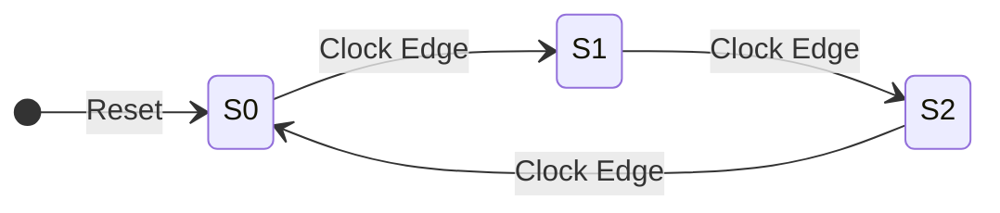
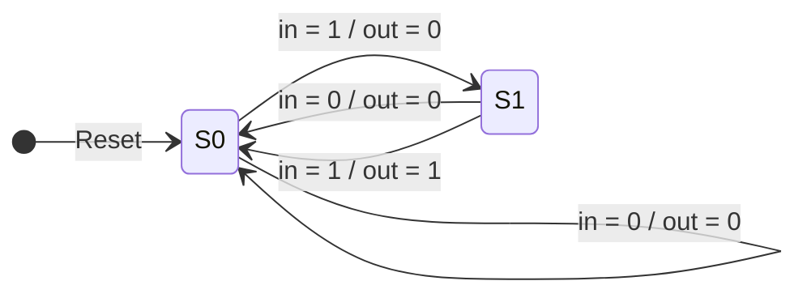
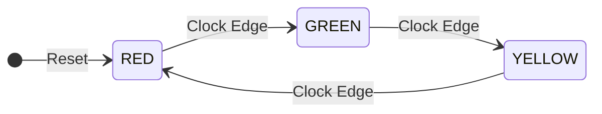
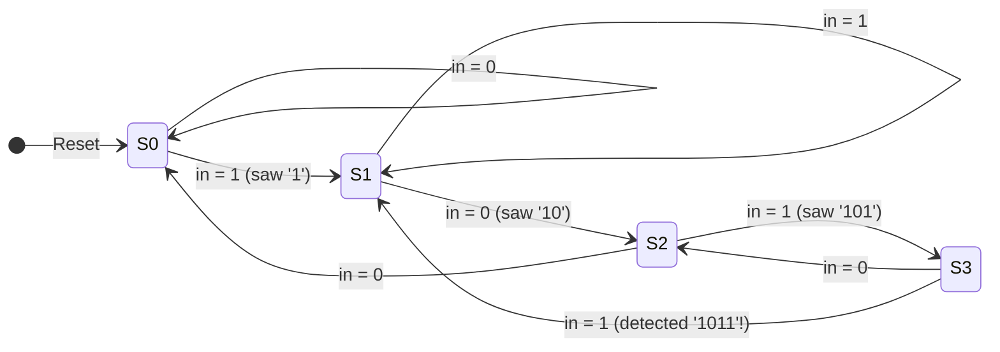

# Task 4 – RTL Design of Finite State Machines (FSM) and Control Units

## 📌 Overview

This task focuses on the design, modeling, and verification of **Finite State Machines (FSMs)** and sequential control logic using **Verilog HDL** and **Xilinx Vivado**. It covers both **Moore** and **Mealy** architectures and applies them to real-world control applications, including a traffic light sequencer and a serial pattern sequence detector.

---

## 🎯 Objectives

- Understand the fundamental differences between Moore and Mealy FSM architectures.
- Implement state registers, next-state transition logic, and output decoding logic in synthesizable RTL.
- Handle asynchronous and synchronous reset conditions reliably.
- Design practical control units:
  - 3-State Moore FSM
  - Conditional Mealy FSM
  - 3-Phase Traffic Light Controller
  - `1011` Serial Sequence Detector (with pattern overlap)
- Develop Verilog testbenches for behavioral simulation in Vivado and evaluate timing waveforms.

---

## 🛠️ Tools & Technologies

| Tool / Technology | Purpose |
|-------------------|---------|
| **Xilinx Vivado** | RTL synthesis, elaboration, and behavioral simulation |
| **Vivado Simulator (xsim)** | State transition verification and waveform debugging |
| **Verilog HDL** | Synthesizable RTL design (`always @(posedge clk or posedge reset)`) |

---

## 📂 Submodules & Circuits Implemented

| Submodule | Type | Design Source | Testbench | Waveform |
|-----------|------|---------------|-----------|----------|
| [Moore FSM](Moore_FSM/) | 3-State Moore | [`moore_fsm.v`](Moore_FSM/moore_fsm.v) | [`tb_moore_fsm.v`](Moore_FSM/tb_moore_fsm.v) | [Waveform](Moore_FSM/moore_fsm_waveform.png) |
| [Mealy FSM](Mealy_FSM/) | 2-State Mealy | [`mealy_fsm.v`](Mealy_FSM/mealy_fsm.v) | [`tb_mealy_fsm.v`](Mealy_FSM/tb_mealy_fsm.v) | [Waveform](Mealy_FSM/mealy_fsm_waveform.png) |
| [Sequence Detector](Sequence_Detector/) | Pattern `1011` Detector | [`sequence_detector.v`](Sequence_Detector/sequence_detector.v) | [`tb_sequence_detector.v`](Sequence_Detector/tb_sequence_detector.v) | [Waveform](Sequence_Detector/sequence_detector_waveform.png) |
| [Traffic Light Controller](Traffic_Light_Controller/) | 3-Color FSM Controller | [`traffic_light_controller.v`](Traffic_Light_Controller/traffic_light_controller.v) | [`tb_traffic_light_controller.v`](Traffic_Light_Controller/tb_traffic_light_controller.v) | [Waveform](Traffic_Light_Controller/traffic_light_waveform.png) |

---

## 🔬 Moore vs. Mealy Architecture

| Feature | Moore FSM | Mealy FSM |
|---------|-----------|-----------|
| **Output Dependency** | Current State only (`Output = f(State)`) | Current State AND Inputs (`Output = f(State, Input)`) |
| **Glitch Susceptibility** | Highly stable (outputs synchronized to clock) | Can glitch if input signals undergo asynchronous changes |
| **State Count** | Typically requires more states | Often requires fewer states for identical functionality |
| **Response Latency** | Changes one clock cycle later | Reacts immediately to input within the same clock period |

---

## 📊 Circuit Highlights

### 1. Moore FSM
Cycles through states continuously: `S0 (2'b00) → S1 (2'b01) → S2 (2'b10) → S0`.



---

### 2. Mealy FSM
Asserts `out = 1` only when `State == S1` **and** input `in == 1`.



---

### 3. Traffic Light Controller
Sequences through standard signal phases: `RED (3'b100) → GREEN (3'b001) → YELLOW (3'b010) → RED`.



---

### 4. 1011 Sequence Detector
Monitors a serial bitstream and asserts `detected = 1` upon matching `1011`. Supports overlapping sequences by returning to state `S1` after detection.



---

## 📁 Folder Structure

```
Task-4/
├── Mealy_FSM/
│   ├── mealy_fsm.v
│   ├── tb_mealy_fsm.v
│   ├── mealy_fsm_waveform.png
│   └── README.md
├── Moore_FSM/
│   ├── moore_fsm.v
│   ├── tb_moore_fsm.v
│   ├── moore_fsm_waveform.png
│   └── README.md
├── Report/
│   └── VLSI_Task_4_Report.docx
├── Sequence_Detector/
│   ├── sequence_detector.v
│   ├── tb_sequence_detector.v
│   ├── sequence_detector_waveform.png
│   └── README.md
├── Traffic_Light_Controller/
│   ├── traffic_light_controller.v
│   ├── tb_traffic_light_controller.v
│   ├── traffic_light_waveform.png
│   └── README.md
└── README.md
```

---

## 📈 Verification & Results

All 4 FSM designs were verified via Vivado behavioral simulation. State transitions, asynchronous reset deassertion, and output reactions matched specification and truth tables with 100% functional accuracy.
