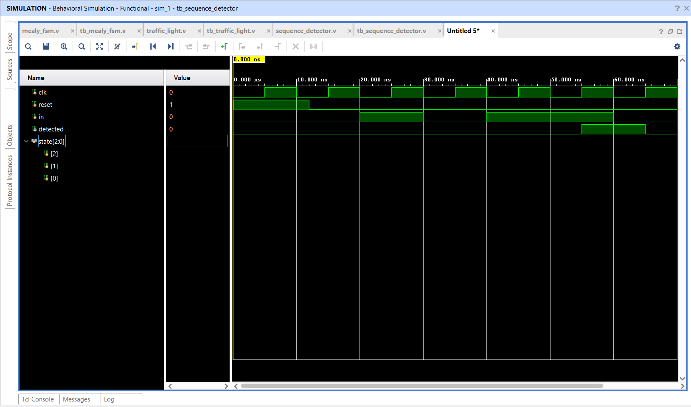

# 1011 Serial Sequence Detector

## 📌 Objective

Design and simulate a synchronous serial sequence detector to identify the 4-bit binary pattern **`1011`** with pattern overlap capability using Verilog HDL.

---

## 🔬 State Machine Design

The FSM tracks incoming bits serially across 4 states:
- **S0 (`3'b000`):** Idle / No matching bits
- **S1 (`3'b001`):** Detected bit `'1'`
- **S2 (`3'b010`):** Detected pattern `'10'`
- **S3 (`3'b011`):** Detected pattern `'101'`

When in **S3** and the incoming bit is `'1'`:
- Full pattern `'1011'` is identified.
- Output flag `detected` goes HIGH (`1`).
- Next state transitions to **S1** (since the trailing `'1'` can serve as the first bit of the next pattern, supporting **overlapping sequence detection**).

---

## 📁 Source Files

| File | Description |
|------|-------------|
| [`sequence_detector.v`](sequence_detector.v) | Verilog RTL module modeling the 1011 sequence detector |
| [`tb_sequence_detector.v`](tb_sequence_detector.v) | Testbench delivering the serial bitstream `1 → 0 → 1 → 1 → 0` |
| [`sequence_detector_waveform.png`](sequence_detector_waveform.png) | Simulation waveform captured from Vivado |

---

## 📊 State Transition Table

| Current State | Encoding | Input `in` | Next State | Next Encoding | Output `detected` |
|:---:|:---:|:---:|:---:|:---:|:---:|
| S0 | `3'b000` | 0 | S0 | `3'b000` | 0 |
| S0 | `3'b000` | 1 | S1 | `3'b001` | 0 |
| S1 | `3'b001` | 0 | S2 | `3'b010` | 0 |
| S1 | `3'b001` | 1 | S1 | `3'b001` | 0 |
| S2 | `3'b010` | 0 | S0 | `3'b000` | 0 |
| S2 | `3'b010` | 1 | S3 | `3'b011` | 0 |
| S3 | `3'b011` | 0 | S2 | `3'b010` | 0 |
| S3 | `3'b011` | 1 | S1 | `3'b001` | **1** (Pattern Detected!) |

---

## 📈 Simulation Waveform

Behavioral simulation in **Xilinx Vivado**:

---

## ✅ Result

The serial sequence detector correctly asserted `detected = 1` immediately following the transmission of `1 → 0 → 1 → 1` and reset the output flag when the sequence broke.
