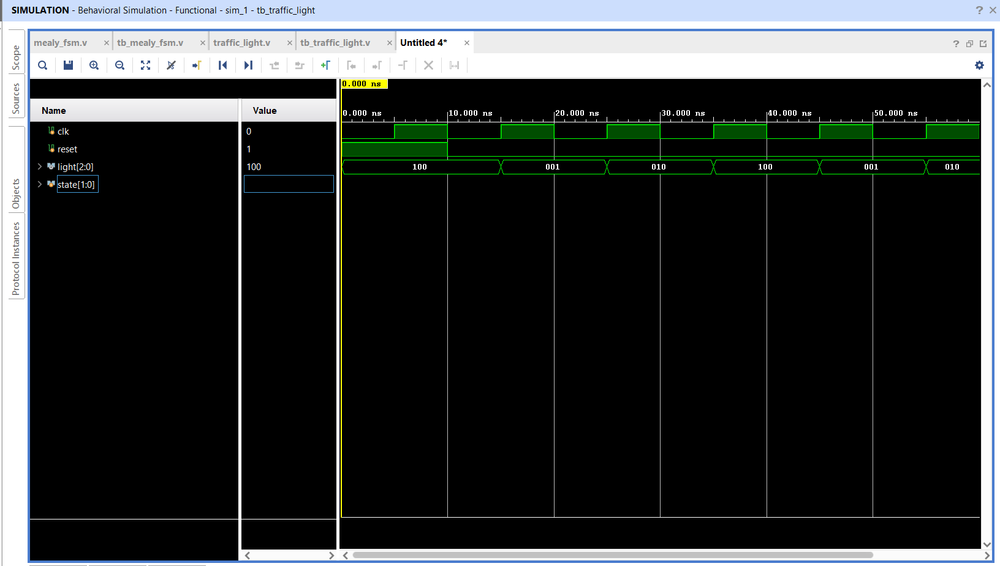

# Traffic Light Controller FSM

## 📌 Objective

Design and simulate a synchronous 3-phase **Traffic Light Controller** using an FSM in Verilog HDL.

---

## 🔬 State Machine Design

The controller transitions cyclically between three signals:
1. **RED (`3'b100`)**: Stop phase
2. **GREEN (`3'b001`)**: Go phase
3. **YELLOW (`3'b010`)**: Caution phase

Sequence:
```
RED (100) → GREEN (001) → YELLOW (010) → RED (100)
```

---

## 📁 Source Files

| File | Description |
|------|-------------|
| [`traffic_light_controller.v`](traffic_light_controller.v) | Verilog RTL module for traffic light controller |
| [`tb_traffic_light_controller.v`](tb_traffic_light_controller.v) | Testbench initializing reset and cycling clock periods |
| [`traffic_light_waveform.png`](traffic_light_waveform.png) | Simulation waveform captured from Vivado |

---

## 📊 State & Light Output Table

| State | State Code | Active Light | Binary Output `light[2:0]` | Next State |
|:---:|:---:|:---:|:---:|:---:|
| S0 | `2'b00` | **GREEN** | `3'b001` | S1 |
| S1 | `2'b01` | **YELLOW** | `3'b010` | S2 |
| S2 | `2'b10` | **RED** | `3'b100` | S0 |

*(Note: On initial reset, state initializes to `S0` with `light = RED` before proceeding to the active sequence).*

---

## 📈 Simulation Waveform

Behavioral simulation in **Xilinx Vivado**:



---

## ✅ Result

The output cleanly iterates through the expected traffic control sequence with synchronous clock transitions.
