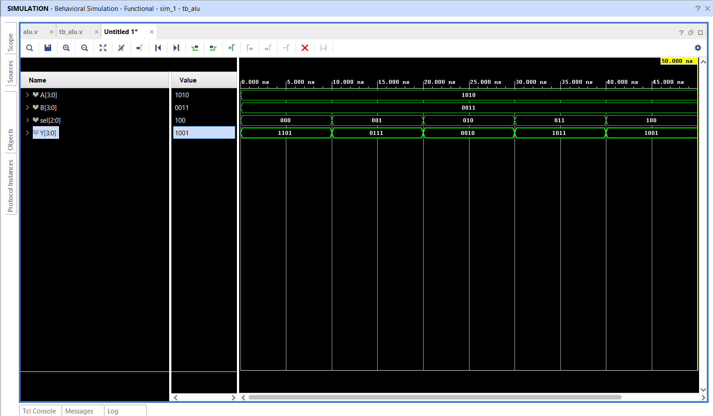

# 4-Bit Arithmetic Logic Unit (ALU)

## 📌 Objective

Design and simulate a 4-bit **Arithmetic Logic Unit (ALU)** supporting fundamental arithmetic and logical operations in Verilog HDL.

---

## 🔬 Operation Table

Operands: 4-bit inputs `A` and `B`, 3-bit control input `sel`, 4-bit output `Y`.

| `sel` | Operation | Expression | Sample Evaluation (`A=1010`, `B=0011`) | Output `Y` |
|:---:|:---:|:---:|:---:|:---:|
| `3'b000` | **ADD** | `A + B` | `1010 + 0011` | `1101` |
| `3'b001` | **SUB** | `A - B` | `1010 - 0011` | `0111` |
| `3'b010` | **AND** | `A & B` | `1010 & 0011` | `0010` |
| `3'b011` | **OR**  | `A \| B` | `1010 \| 0011` | `1011` |
| `3'b100` | **XOR** | `A ^ B` | `1010 ^ 0011` | `1001` |

---

## 📁 Source Files

| File | Description |
|------|-------------|
| [`alu.v`](alu.v) | Verilog RTL behavioral implementation using `case(sel)` |
| [`tb_alu.v`](tb_alu.v) | Testbench applying stimulus for all operation codes |
| [`alu_waveform.png`](alu_waveform.png) | Simulation waveform captured from Vivado |

---

## 📈 Simulation Waveform

Behavioral simulation in **Xilinx Vivado**:

---

## ✅ Result

All five ALU operations produced the expected arithmetic and logical results in Vivado simulation.
