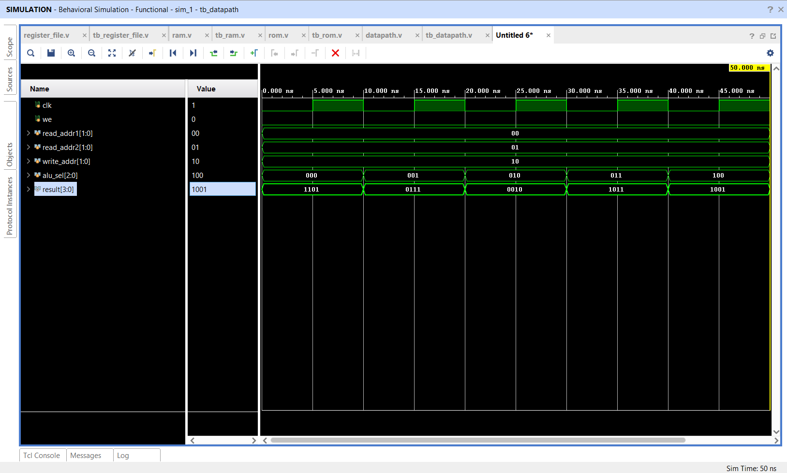

# Mini Processor Datapath with ALU Write-Back

## 📌 Objective

Design, integrate, and verify a **Mini Processor Datapath** combining a 4-register bank, dual operand multiplexing, an Arithmetic Logic Unit (ALU), and an active-high synchronous result write-back bus in Verilog HDL.

---

## 🔬 Datapath Architecture

The datapath implements the classic register-transfer compute and write-back cycle:

```
[Register File: R0..R3]
      │           │
  (read_addr1)(read_addr2)
      │           │
      ▼           ▼
    data1       data2
      │           │
      └─────┬─────┘
            ▼
        [  ALU  ] ◄── alu_sel
            │
            ▼
        alu_result ─────────────────────────┐
            │                               │
            ▼                               ▼
       result (output)             (if we == 1, posedge clk)
                                            │
                                            ▼
                               registers[write_addr] <= alu_result
```

### Key Ports:
- `clk`: Clock signal for synchronous write operations.
- `we`: Write enable for committing ALU results into the register bank.
- `read_addr1`, `read_addr2`: 2-bit addresses for simultaneous reading of two register operands.
- `write_addr`: 2-bit destination register address.
- `alu_sel`: 3-bit ALU operation selector (`000`: ADD, `001`: SUB, `010`: AND, `011`: OR, `100`: XOR).
- `result`: 4-bit output exposing the computed ALU value.

---

## 📁 Source Files

| File | Description |
|------|-------------|
| [`datapath.v`](datapath.v) | Top-level integrated Datapath module |
| [`tb_datapath.v`](tb_datapath.v) | Comprehensive testbench verifying ALU operations and R2 write-back |
| [`datapath_waveform.png`](datapath_waveform.png) | Simulation waveform captured from Vivado |

---

## 📊 Verification Walkthrough

In the testbench, registers are initialized:
- `R0 = 4'b1010` (10)
- `R1 = 4'b0011` (3)
- `R2 = 4'b0000` (Destination)
- `read_addr1 = 2'b00`, `read_addr2 = 2'b01`

1. **ADD:** `alu_sel = 000` → `R0 + R1 = 1010 + 0011 = 1101`
2. **SUB:** `alu_sel = 001` → `R0 - R1 = 1010 - 0011 = 0111`
3. **AND:** `alu_sel = 010` → `R0 & R1 = 1010 & 0011 = 0010`
4. **OR:** `alu_sel = 011` → `R0 | R1 = 1010 | 0011 = 1011`
5. **XOR:** `alu_sel = 100` → `R0 ^ R1 = 1010 ^ 0011 = 1001`
6. **Write-Back to R2:**
   - Set `alu_sel = 3'b000` (ADD result `1101`).
   - Set `write_addr = 2'b10` and `we = 1`.
   - On clock edge, `uut.registers[2]` receives `1101`.
7. **Read-Back Verification:**
   - Configure `read_addr1 = 2'b10`, `read_addr2 = 2'b10`.
   - Read port confirms persistent storage of `1101` inside register `R2`.

---

## 📈 Simulation Waveform

Behavioral simulation in **Xilinx Vivado**:



---

## ✅ Result

The integrated datapath successfully performed dual-operand fetching, ALU computation, and clocked write-back to the target register without data corruption.
