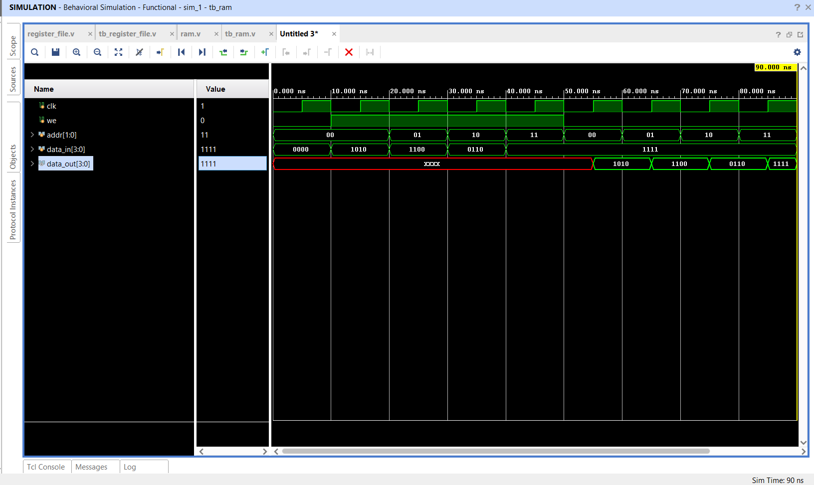

# Random Access Memory (RAM)

## 📌 Objective

Design and simulate a synchronous 4-location × 4-bit **Random Access Memory (RAM)** using Verilog HDL.

---

## 🔬 Architecture & Specification

- **Memory Array:** `reg [3:0] memory [3:0]` (4 words of 4 bits each).
- **Address Line:** 2-bit `addr` allowing access to locations `00`, `01`, `10`, `11`.
- **Clocking:** Positive-edge clock triggered (`posedge clk`).
- **Control Signal:** Write enable (`we`).
  - When `we = 1`: Performs synchronous write (`memory[addr] <= data_in`).
  - When `we = 0`: Performs synchronous read (`data_out <= memory[addr]`).

---

## 📁 Source Files

| File | Description |
|------|-------------|
| [`ram.v`](ram.v) | Verilog RTL module for synchronous RAM |
| [`tb_ram.v`](tb_ram.v) | Testbench sequencing multi-word writes followed by reads |
| [`ram_waveform.png`](ram_waveform.png) | Simulation waveform captured from Vivado |

---

## 📊 Verification Sequence

| Phase | Time (ns) | `we` | Address `addr` | Data In `data_in` | Output `data_out` |
|:---:|:---:|:---:|:---:|:---:|:---:|
| Write | 10 | 1 | `2'b00` | `4'b1010` | — |
| Write | 20 | 1 | `2'b01` | `4'b1100` | — |
| Write | 30 | 1 | `2'b10` | `4'b0110` | — |
| Write | 40 | 1 | `2'b11` | `4'b1111` | — |
| Read  | 50 | 0 | `2'b00` | — | `4'b1010` |
| Read  | 60 | 0 | `2'b01` | — | `4'b1100` |
| Read  | 70 | 0 | `2'b10` | — | `4'b0110` |
| Read  | 80 | 0 | `2'b11` | — | `4'b1111` |

---

## 📈 Simulation Waveform

Behavioral simulation in **Xilinx Vivado**:

---

## ✅ Result

The RAM block performed deterministic write and read operations across all address spaces synchronous to the clock.
