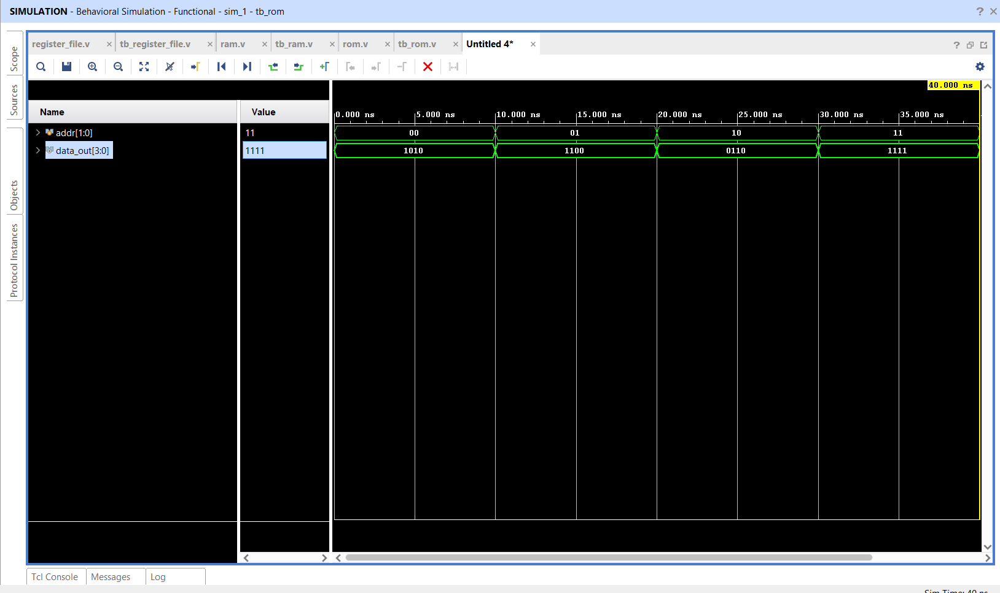

# Read-Only Memory (ROM)

## 📌 Objective

Design and simulate a 4-location × 4-bit combinational **Read-Only Memory (ROM)** initialized with fixed contents using Verilog HDL.

---

## 🔬 Architecture & Specification

- **Address Bus:** 2-bit `addr` (`00`, `01`, `10`, `11`).
- **Data Bus:** 4-bit output `data_out`.
- **Latency:** Combinational readout (`always @(*)`) with zero clock cycle latency.

---

## 📁 Source Files

| File | Description |
|------|-------------|
| [`rom.v`](rom.v) | Verilog RTL combinational ROM module using `case(addr)` |
| [`tb_rom.v`](tb_rom.v) | Testbench cycling through all 4 addresses |
| [`rom_waveform.png`](rom_waveform.png) | Simulation waveform captured from Vivado |

---

## 📊 Pre-Programmed Data Contents

| Address (`addr`) | Binary Data (`data_out`) | Hex Value |
|:---:|:---:|:---:|
| `2'b00` | `4'b1010` | `0xA` |
| `2'b01` | `4'b1100` | `0xC` |
| `2'b10` | `4'b0110` | `0x6` |
| `2'b11` | `4'b1111` | `0xF` |

---

## 📈 Simulation Waveform

Behavioral simulation in **Xilinx Vivado**:

---

## ✅ Result

Simulated waveforms confirmed that changing the address immediately updates `data_out` with the corresponding permanent lookup value.
