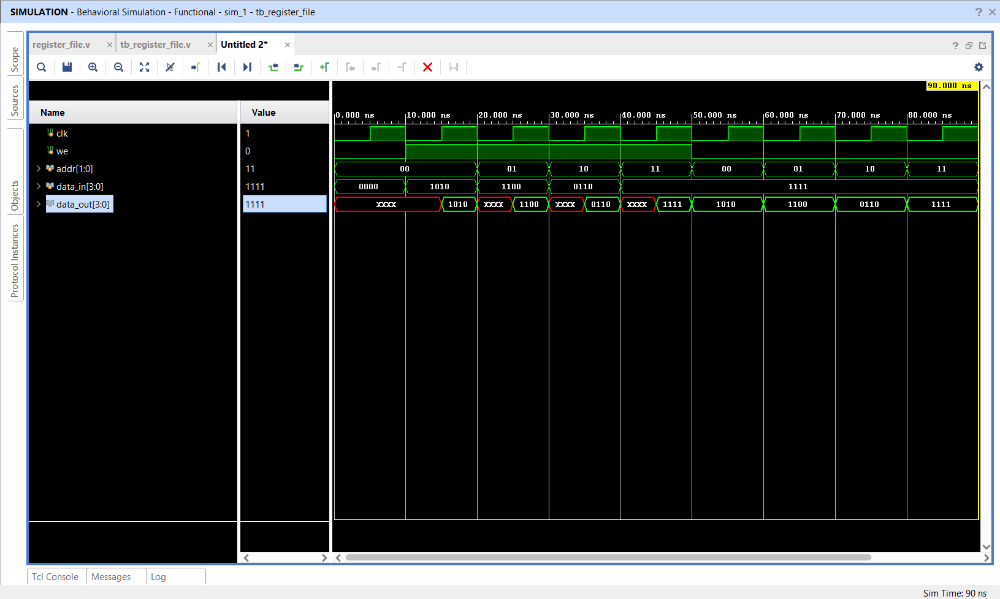

# Multi-Port Register File

## 📌 Objective

Design and simulate a 4×4-bit multi-register storage array supporting synchronous write and asynchronous read using Verilog HDL.

---

## 🔬 Architecture & Specification

- **Registers:** 4 general-purpose registers (`R0` through `R3`), each 4 bits wide.
- **Address Bus:** 2-bit `addr` (`2'b00` → R0, `2'b01` → R1, `2'b10` → R2, `2'b11` → R3).
- **Write Control:** Synchronous write on `posedge clk` when write enable `we = 1`.
- **Read Operation:** Asynchronous continuous read directly from `regfile[addr]`.

---

## 📁 Source Files

| File | Description |
|------|-------------|
| [`register_file.v`](register_file.v) | Verilog RTL module for 4×4-bit register file |
| [`tb_register_file.v`](tb_register_file.v) | Testbench writing and reading all 4 register locations |
| [`register_file_waveform.png`](register_file_waveform.png) | Simulation waveform captured from Vivado |

---

## 📊 Verification Sequence

| Phase | `we` | Address `addr` | Data In `data_in` | Action / Expected Output |
|:---:|:---:|:---:|:---:|:---|
| Write | 1 | `2'b00` | `4'b1010` | Write `1010` into R0 |
| Write | 1 | `2'b01` | `4'b1100` | Write `1100` into R1 |
| Write | 1 | `2'b10` | `4'b0110` | Write `0110` into R2 |
| Write | 1 | `2'b11` | `4'b1111` | Write `1111` into R3 |
| Read  | 0 | `2'b00` | — | Read `data_out = 1010` |
| Read  | 0 | `2'b01` | — | Read `data_out = 1100` |
| Read  | 0 | `2'b10` | — | Read `data_out = 0110` |
| Read  | 0 | `2'b11` | — | Read `data_out = 1111` |

---

## 📈 Simulation Waveform

Behavioral simulation in **Xilinx Vivado**:

---

## ✅ Result

Data was accurately written into each indexed register slot on clock edges and reliably retrieved during read operations.
